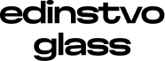

Edinstvo Glass for Figma is real glass in your designs.

It is a live shader effect with the same lens as [`@edinstvo/glass`](https://github.com/EdinstvoAI/edinstvo-glass): light bends at a curved edge, colours split and what is behind frosts. Nothing is baked, so the glass follows your layer as it changes.

## Documentation

See the full documentation of the glass and every setting at [edinstvoai.github.io/edinstvo-glass-site/docs](https://edinstvoai.github.io/edinstvo-glass-site/docs/).

## Use

Add the Edinstvo Glass effect to a layer and the whole layer becomes glass. Its fill is the colour of the glass, and the material settings are named as in the package.

## Source

`main.ts` is the source of the effect, in WGSL and WebGPU.

## Contributing

Issues and pull requests are welcome at [github.com/EdinstvoAI/edinstvo-glass-plugin](https://github.com/EdinstvoAI/edinstvo-glass-plugin).

## License

MIT
